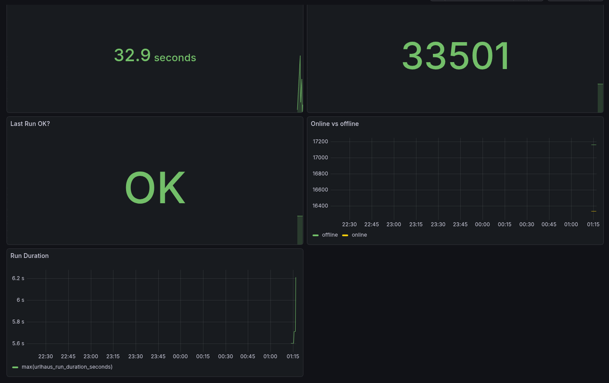
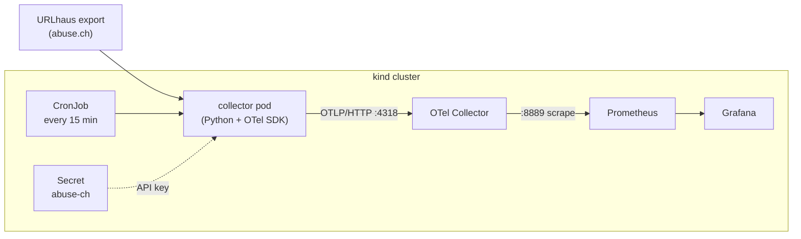
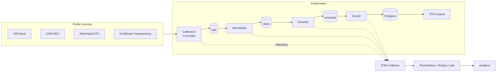

# ioc-observatory

A Kubernetes-native threat-intelligence (OSINT) pipeline, instrumented end to end with OpenTelemetry. It collects public Indicators of Compromise (IOCs) on a schedule and reports how the pipeline itself is performing, so each data source can be judged on freshness, reliability and usefulness.

> **Status: Phase 1 complete.** A URLhaus collector runs as a Kubernetes CronJob, pushes OpenTelemetry metrics through an OTel Collector to Prometheus, and is visualised in Grafana. Storage, more sources, queued pipeline stages and tracing are planned (see the [roadmap](#roadmap)). Anything not marked as built is a plan, not a feature.



## What works today

| Component | Detail |
|---|---|
| URLhaus collector | Python script that downloads abuse.ch's recent-URLs export and summarises it |
| Scheduling | Kubernetes CronJob, every 15 minutes, with a Secret for the API key |
| Telemetry | OpenTelemetry metrics pushed (OTLP/HTTP) to an OTel Collector, exposed to Prometheus |
| Visualisation | Grafana dashboard with five panels (JSON in `observability/dashboards/`) |
| Runtime | Local `kind` cluster (Kubernetes in Docker) |

## Architecture (built)



The collector is a short-lived batch job (about 15-20 seconds per run), so it **pushes** its metrics to the OTel Collector before exiting instead of waiting to be scraped. The Collector holds the latest values and exposes them for Prometheus.

## Metrics

All are gauges describing the latest run. Names are as they appear in Prometheus.

| Metric | Meaning |
|---|---|
| `urlhaus_records_fetched` | Rows in the feed at the last run |
| `urlhaus_records_by_status{status}` | Rows per `url_status` (`online` / `offline`) |
| `urlhaus_run_duration_seconds` | Run time of the last run |
| `urlhaus_last_run_success` | `1` if the last run succeeded, `0` otherwise |
| `urlhaus_last_success_timestamp_seconds` | Unix time of the last successful run (used for data age) |

Dashboard queries wrap these in `max(...)` / `max by (status) (...)` so that series left over from Collector pod restarts do not show up as duplicates.

## Repository layout

```
.
├── collectors/
│   └── urlhaus/
│       ├── collector.py        # fetch + parse + emit metrics
│       ├── requirements.txt
│       └── Dockerfile
├── k8s/
│   └── urlhaus-cronjob.yaml    # CronJob (reads the abuse-ch Secret)
├── observability/
│   ├── otel-collector-values.yaml   # Helm values for the OTel Collector
│   └── dashboards/
│       └── urlhaus.json        # Grafana dashboard export
├── pipeline/                   # planned: normaliser, enricher, scorer
├── docs/
└── README.md
```

## Run it locally

Prerequisites: Docker, `kind`, `kubectl`, Helm, Python 3, and a free abuse.ch Auth-Key from [auth.abuse.ch](https://auth.abuse.ch).

**1. Configure the key (never commit it)**

```bash
cp .env.example .env      # then edit .env
# ABUSE_CH_AUTH_KEY=your-key-here   (no quotes, no spaces around "=")
```

`.env` is listed in `.gitignore`. Confirm with `git check-ignore -v .env`.

**2. Try the collector without Kubernetes**

```bash
python3 -m venv .venv && source .venv/bin/activate
python -m pip install -r collectors/urlhaus/requirements.txt
python collectors/urlhaus/collector.py
```

**3. Create the cluster and the monitoring stack**

```bash
kind create cluster --name ioc
kubectl wait --for=condition=Ready node --all --timeout=180s
kubectl create namespace monitoring

helm repo add prometheus-community https://prometheus-community.github.io/helm-charts
helm repo add grafana https://grafana.github.io/helm-charts
helm repo add open-telemetry https://open-telemetry.github.io/opentelemetry-helm-charts
helm repo update

helm install prometheus prometheus-community/prometheus -n monitoring \
  --set alertmanager.enabled=false \
  --set prometheus-pushgateway.enabled=false \
  --set server.persistentVolume.enabled=false

helm install grafana grafana/grafana -n monitoring --set persistence.enabled=false

helm install otel-collector open-telemetry/opentelemetry-collector -n monitoring \
  -f observability/otel-collector-values.yaml
```

**4. Build, load and schedule the collector**

```bash
docker build -t urlhaus-collector:0.2 collectors/urlhaus
kind load docker-image urlhaus-collector:0.2 --name ioc
kubectl create secret generic abuse-ch --from-env-file=.env
kubectl apply -f k8s/urlhaus-cronjob.yaml
kubectl create job --from=cronjob/urlhaus-collector urlhaus-manual-1   # run once now
kubectl logs job/urlhaus-manual-1
```

**5. Open Grafana**

```bash
kubectl port-forward -n monitoring svc/grafana 3000:80
# user: admin, password:
kubectl get secret -n monitoring grafana -o jsonpath="{.data.admin-password}" | base64 -d; echo
```

Add a Prometheus data source with URL `http://prometheus-server.monitoring.svc.cluster.local`, then import `observability/dashboards/urlhaus.json` (Dashboards → New → Import).

## Design decisions

| Decision | Reason |
|---|---|
| Push metrics (OTLP) instead of letting Prometheus scrape the job | The job lives about 15-20 seconds, shorter than a typical scrape interval |
| `force_flush()` before exit | Otherwise metrics from a short run would be lost |
| Gauges, not counters | Every run is a new process, so counters would reset to zero each time |
| `metric_expiration: 30m` on the Collector's Prometheus exporter | The default (about 5 minutes) would drop the metrics between 15-minute runs |
| `otel-collector-contrib` image | The slimmer `-k8s` image has no Prometheus exporter and crashes on start |
| API key kept out of logs and traces | URLhaus puts the key in the request URL, so the script prints only exception *types*, never messages |
| Non-zero exit on failure | Kubernetes marks the Job failed, so failures are visible in `kubectl get jobs` |

## Security notes

- API keys live in `.env` (gitignored) locally and in a Kubernetes Secret in the cluster. No secret values are committed.
- Kubernetes Secrets are only base64-encoded, not encrypted. That is acceptable for a local learning cluster but not for production, where an external secret store or encryption at rest would be used.
- All collection is passive: public data and official APIs only, with no scanning or probing of third-party systems.
- Respect each provider's terms. abuse.ch asks that the export is not fetched more often than every 5 minutes and may require a subscription for commercial use.

## Known limitations

- One data source so far, and results are not stored: each run overwrites the previous run's numbers.
- Without a persistent volume, Prometheus loses its history when its pod or the VM restarts. Grafana also loses its settings, so keep the exported dashboard JSON up to date.
- "Records fetched" is the size of the whole rolling feed, not the number of *new* IOCs. Detecting new versus already-seen IOCs is planned for Phase 2.
- Runs on a single-node local cluster with no high availability.
- Free feeds are lower in coverage and quality than commercial threat intelligence, so this is an engineering and learning project, not a production security product.

## Roadmap

| Phase | Deliverable | Done |
|---|---|---|
| 1 | URLhaus collector as a CronJob, OTel metrics, Prometheus and Grafana dashboard | [x] |
| 2 | Common IOC schema, Postgres storage, new-vs-seen detection, CISA KEV and AlienVault OTX collectors | [ ] |
| 3 | Queued pipeline stages (normalise, enrich, score) and end-to-end tracing per IOC | [ ] |
| 4 | Certificate Transparency lookalike monitor, scoring, STIX export | [ ] |

### Target architecture (Phases 2-4, planned)


