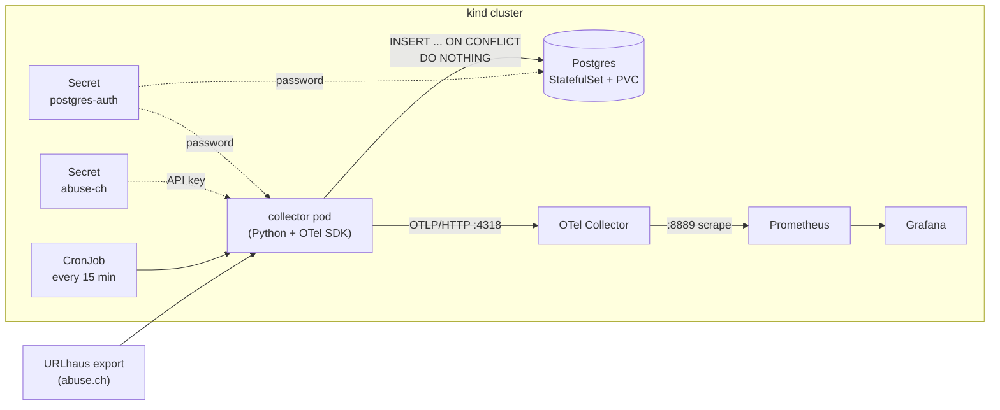
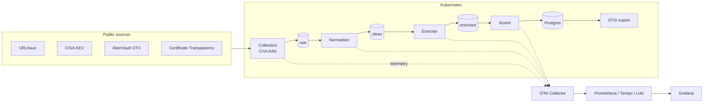

# ioc-observatory

A Kubernetes-native threat-intelligence (OSINT) pipeline, instrumented end to end with OpenTelemetry. It collects public Indicators of Compromise (IOCs) on a schedule, stores them in Postgres, and reports how the pipeline itself is performing, so each data source can be judged on freshness, reliability and usefulness.

> **Status: Phase 1 complete, Phase 2 in progress.** A URLhaus collector runs as a Kubernetes CronJob, stores every IOC in an in-cluster Postgres database (detecting which ones are new), pushes OpenTelemetry metrics through an OTel Collector to Prometheus, and is visualised in Grafana. More sources, queued pipeline stages and tracing are planned (see the [roadmap](#roadmap)). Anything not marked as built is a plan, not a feature.


## What works today

| Component | Detail |
|---|---|
| URLhaus collector | Python script that downloads abuse.ch's recent-URLs export, maps each row to a common IOC schema and stores it |
| Common IOC schema | One dataclass (`common/ioc.py`) that every source will map into |
| Storage | Postgres 16 in the cluster (StatefulSet with a 1 GiB PersistentVolumeClaim); data survives pod restarts |
| New-vs-seen detection | `UNIQUE (source, source_id)` plus `INSERT ... ON CONFLICT DO NOTHING`; each run reports how many IOCs were new |
| Scheduling | Kubernetes CronJob, every 15 minutes, with Secrets for the API key and the database password |
| Telemetry | OpenTelemetry metrics pushed (OTLP/HTTP) to an OTel Collector, exposed to Prometheus |
| Visualisation | Grafana dashboard with seven panels (JSON in `observability/dashboards/`) |
| Runtime | Local `kind` cluster (Kubernetes in Docker) |

## Architecture (built)



The collector is a short-lived batch job (about 15-30 seconds per run), so it **pushes** its metrics to the OTel Collector before exiting instead of waiting to be scraped. The Collector holds the latest values and exposes them for Prometheus.

## Data model

One table holds indicators from every source. Columns mirror the `IOC` dataclass in `common/ioc.py`.

| Column | Type | Meaning |
|---|---|---|
| `source` / `source_id` | text | Source name and the source's own ID. Together they are unique |
| `ioc_type` | text | `url` today; `domain`, `ip`, `cve` planned |
| `value` | text | The indicator itself |
| `first_seen` / `last_seen` | timestamptz | As reported by the source (UTC) |
| `status`, `threat` | text | e.g. `online` / `offline`, `malware_download` |
| `tags` | text[] | Source tags |
| `reference_url` | text | Link back to the source's page |
| `ingested_at` | timestamptz | When this project first stored it (defaults to `now()`) |

The schema is in `db/schema.sql`.

## Metrics

All are gauges describing the latest run. Names are as they appear in Prometheus.

| Metric | Meaning |
|---|---|
| `urlhaus_records_fetched` | Rows in the feed at the last run |
| `urlhaus_records_by_status{status}` | Rows per `url_status` (`online` / `offline`) |
| `urlhaus_records_new` | IOCs stored for the first time in the last run |
| `urlhaus_db_total` | Total IOCs stored in Postgres after the last run |
| `urlhaus_run_duration_seconds` | Run time of the last run |
| `urlhaus_last_run_success` | `1` if the last run succeeded, `0` otherwise |
| `urlhaus_last_success_timestamp_seconds` | Unix time of the last successful run (used for data age) |

Dashboard queries wrap these in `max(...)` / `max by (status) (...)` so that series left over from Collector pod restarts do not show up as duplicates.

## Dashboard

| Panel | What it answers |
|---|---|
| Last Run OK? | Did the latest collector run succeed? |
| Data Age | How long since the last successful run (green under 20 minutes, red over 30) |
| Records in feed | Size of the rolling URLhaus feed at the last run |
| Total IOCs stored | Unique indicators in Postgres |
| New IOCs per run | How many indicators were seen for the first time |
| Online vs offline | Feed split by `url_status` |
| Run Duration | How long each run takes |

## Repository layout

```
.
├── collectors/
│   └── urlhaus/
│       ├── collector.py        # fetch + parse + store + emit metrics
│       ├── requirements.txt
│       └── Dockerfile          # built from the repo root (copies common/)
├── common/
│   ├── ioc.py                  # IOC dataclass and the URLhaus mapper
│   └── db.py                   # save_iocs(): insert and count new vs seen
├── db/
│   └── schema.sql              # iocs table and indexes
├── k8s/
│   ├── postgres.yaml           # Service + StatefulSet + PVC claim template
│   └── urlhaus-cronjob.yaml    # CronJob (reads both Secrets)
├── observability/
│   ├── otel-collector-values.yaml   # Helm values for the OTel Collector
│   └── dashboards/
│       └── urlhaus.json        # Grafana dashboard export
├── pipeline/                   # planned: normaliser, enricher, scorer
├── docs/
├── .env.example
├── .dockerignore
└── README.md
```

## Run it locally

Prerequisites: Docker, `kind`, `kubectl`, Helm, Python 3, `openssl`, and a free abuse.ch Auth-Key from [auth.abuse.ch](https://auth.abuse.ch).

**1. Configure the key (never commit it)**

```bash
cp .env.example .env      # then edit .env
# ABUSE_CH_AUTH_KEY=your-key-here   (no quotes, no spaces around "=")
```

`.env` is listed in `.gitignore`. Confirm with `git check-ignore -v .env`.

**2. Create the cluster and the monitoring stack**

```bash
kind create cluster --name ioc
kubectl wait --for=condition=Ready node --all --timeout=180s
kubectl create namespace monitoring

helm repo add prometheus-community https://prometheus-community.github.io/helm-charts
helm repo add grafana https://grafana.github.io/helm-charts
helm repo add open-telemetry https://open-telemetry.github.io/opentelemetry-helm-charts
helm repo update

helm install prometheus prometheus-community/prometheus -n monitoring \
  --set alertmanager.enabled=false \
  --set prometheus-pushgateway.enabled=false \
  --set server.persistentVolume.enabled=false

helm install grafana grafana/grafana -n monitoring --set persistence.enabled=false

helm install otel-collector open-telemetry/opentelemetry-collector -n monitoring \
  -f observability/otel-collector-values.yaml
```

**3. Deploy Postgres and create the table**

```bash
# Password is generated in the cluster and never written to a file
kubectl create secret generic postgres-auth \
  --from-literal=POSTGRES_PASSWORD="$(openssl rand -base64 18 | tr -d '/+=')"

kubectl apply -f k8s/postgres.yaml
kubectl wait --for=condition=Ready pod/postgres-0 --timeout=120s
kubectl exec -i postgres-0 -- psql -U ioc -d ioc < db/schema.sql
```

**4. Build, load and schedule the collector**

The image is built from the **repo root** so that `common/` is included.

```bash
docker build -f collectors/urlhaus/Dockerfile -t urlhaus-collector:0.4 .
kind load docker-image urlhaus-collector:0.4 --name ioc
kubectl create secret generic abuse-ch --from-env-file=.env
kubectl apply -f k8s/urlhaus-cronjob.yaml
kubectl create job --from=cronjob/urlhaus-collector urlhaus-manual-1   # run once now
kubectl logs job/urlhaus-manual-1
```

The first run stores the whole feed (about 33,000 IOCs). Run a second job and the `new IOCs:` line should drop to a small number.

The collector now needs Postgres, so it runs inside the cluster rather than directly on the host.

**5. Look at the data**

```bash
kubectl exec -it postgres-0 -- psql -U ioc -d ioc \
  -c "SELECT source, status, count(*) FROM iocs GROUP BY 1, 2;"
```

**6. Open Grafana**

```bash
kubectl port-forward -n monitoring svc/grafana 3000:80
# user: admin, password:
kubectl get secret -n monitoring grafana -o jsonpath="{.data.admin-password}" | base64 -d; echo
```

Add a Prometheus data source with URL `http://prometheus-server.monitoring.svc.cluster.local`, then import `observability/dashboards/urlhaus.json` (Dashboards, New, Import).

## Design decisions

| Decision | Reason |
|---|---|
| Push metrics (OTLP) instead of letting Prometheus scrape the job | The job lives about 15-30 seconds, shorter than a typical scrape interval |
| `force_flush()` before exit | Otherwise metrics from a short run would be lost |
| Gauges, not counters | Every run is a new process, so counters would reset to zero each time |
| `metric_expiration: 30m` on the Collector's Prometheus exporter | The default (about 5 minutes) would drop the metrics between 15-minute runs |
| `otel-collector-contrib` image | The slimmer `-k8s` image has no Prometheus exporter and crashes on start |
| API key kept out of logs and traces | URLhaus puts the key in the request URL, so the script prints only exception *types*, never messages |
| Non-zero exit on failure | Kubernetes marks the Job failed, so failures are visible in `kubectl get jobs` |
| Postgres as a StatefulSet with a PVC | A database needs a stable pod identity and a disk that outlives the pod; a Deployment gives neither |
| `PGDATA` set to a subfolder of the volume | A fresh volume contains `lost+found`, which Postgres refuses to initialise over |
| `UNIQUE (source, source_id)` with `ON CONFLICT DO NOTHING` | The database itself decides new vs already-seen, so the collector stays simple and re-runs are safe |
| Standard `PG*` environment variables, password from a Secret | The driver reads them automatically, so no credentials appear in code, images or the repo |
| Image built from the repo root | The collector shares `common/` with future collectors, so the Docker context must include it |
| Memory limit raised to 512Mi | The whole feed (about 33,000 rows) is held in memory as dicts, IOC objects and tuples |

## Security notes

- API keys live in `.env` (gitignored) locally and in Kubernetes Secrets in the cluster. The Postgres password is generated inside the cluster and never written to a file. No secret values are committed.
- Kubernetes Secrets are only base64-encoded, not encrypted. That is acceptable for a local learning cluster but not for production, where an external secret store or encryption at rest would be used.
- `.dockerignore` keeps `.env`, `.git` and the virtualenv out of image builds.
- All collection is passive: public data and official APIs only, with no scanning or probing of third-party systems.
- Respect each provider's terms. abuse.ch asks that the export is not fetched more often than every 5 minutes and may require a subscription for commercial use.

## Known limitations

- One data source so far (URLhaus). CISA KEV and AlienVault OTX are planned.
- IOCs are stored once, on first sight. If a URL later changes status (online to offline), the stored `status` and `last_seen` are **not** updated.
- No retention or pruning, so the table only grows. The volume is 1 GiB, which is ample at this scale.
- "New IOCs" is computed by counting rows before and after the insert, which assumes one writer at a time. The CronJob's `concurrencyPolicy: Forbid` enforces that.
- Postgres data survives pod deletion and restarts of the kind node, but not `kind delete cluster`.
- Without a persistent volume, Prometheus loses its history when its pod or the VM restarts. Grafana also loses its settings, so keep the exported dashboard JSON up to date.
- Runs on a single-node local cluster with no high availability.
- Free feeds are lower in coverage and quality than commercial threat intelligence, so this is an engineering and learning project, not a production security product.

## Roadmap

| Phase | Deliverable | Done |
|---|---|---|
| 1 | URLhaus collector as a CronJob, OTel metrics, Prometheus and Grafana dashboard | [x] |
| 2 | Common IOC schema, Postgres storage, new-vs-seen detection, CISA KEV and AlienVault OTX collectors | In progress |
| 3 | Queued pipeline stages (normalise, enrich, score) and end-to-end tracing per IOC | [ ] |
| 4 | Certificate Transparency lookalike monitor, scoring, STIX export | [ ] |

**Phase 2 breakdown**

- [x] Common IOC schema (`common/ioc.py`)
- [x] In-cluster Postgres with persistent storage
- [x] New-vs-seen detection, with new and total counts in the dashboard
- [ ] CISA KEV collector
- [ ] AlienVault OTX collector
- [ ] Update existing rows (status, last seen) when an IOC is seen again

### Target architecture (Phases 2-4, planned)


