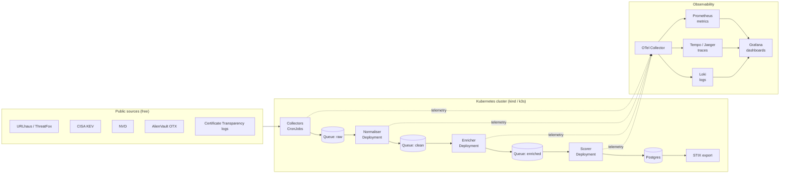

# ioc-observatory

A Kubernetes-native pipeline that collects public threat intelligence (OSINT), normalises and scores it, and is fully instrumented with OpenTelemetry so you can see how the pipeline itself is performing.

> **Status:** Planning / early build. Everything below describes the target design. Items are marked as built only once they actually run.

## What it does

The engine pulls Indicators of Compromise (IOCs) such as malicious URLs, domains, IPs and vulnerabilities from free public sources, converts them into one common format, removes duplicates, enriches them with context, assigns a confidence score, and exports the result for use by other security tools.

OpenTelemetry records metrics, traces and logs for every stage, so each IOC can be followed end to end and each data source can be judged on freshness, reliability and usefulness.

## Architecture



## Pipeline stages

| Stage | Runs as | Responsibility |
|---|---|---|
| Collect | CronJob | Fetch each source on a schedule, push raw records to the queue |
| Normalise | Deployment | Map every source to one common IOC schema |
| Deduplicate | Within normaliser | Merge repeat sightings of the same indicator |
| Enrich | Deployment | Add context (DNS, ASN, geolocation, cross-source sightings) |
| Score | Deployment | Compute a confidence score from source count, recency and reliability |
| Store / export | Postgres + job | Persist results and export as STIX bundles |

## Observability

| Signal | Examples |
|---|---|
| Metrics | IOCs ingested per source, source freshness, error and rate-limit counts, queue depth |
| Traces | One trace per IOC through collect, normalise, enrich and score, so the trace ID acts as provenance |
| Logs | Structured logs from each stage, correlated to traces |

Questions the dashboards should answer:
- Which sources produce the most useful IOCs, and which are mostly noise?
- Is any feed stale, failing or rate-limiting?
- Where do items spend the most time or fail?

## Data sources

| Source | Data | Cost |
|---|---|---|
| abuse.ch (URLhaus, ThreatFox) | Malicious URLs and IOCs | Free (account key) |
| CISA KEV | Actively exploited vulnerabilities | Free |
| NVD | CVE data | Free (optional API key) |
| AlienVault OTX | Community threat pulses | Free (account key) |
| Certificate Transparency | New certificates, used for lookalike domain detection | Free |

All collection is passive and uses public data or official APIs only. No scanning or probing of third-party systems.

## Tech stack

| Layer | Tooling |
|---|---|
| Language | Python |
| Orchestration | Kubernetes (kind or k3s locally) |
| Messaging | Redis or NATS |
| Storage | Postgres |
| Telemetry | OpenTelemetry SDK + OTel Collector |
| Backends | Prometheus, Tempo/Jaeger, Loki, Grafana |
| Export format | STIX 2.1 |

## Roadmap

| Phase | Weeks | Deliverable | Done |
|---|---|---|---|
| 1 | 1-2 | URLhaus collector as a CronJob, OTel metrics, first Grafana dashboard | [X] |
| 2 | 3-4 | Add CISA KEV and OTX, common IOC schema, Postgres storage | [ ] |
| 3 | 5-8 | Split into queued stages, end-to-end tracing per IOC | [ ] |
| 4 | 9-12 | Certificate Transparency lookalike monitor, scoring, STIX export | [ ] |

## Repository layout (planned)

```
.
├── collectors/        # one module per source
├── pipeline/          # normaliser, enricher, scorer
├── k8s/               # manifests: CronJobs, Deployments, ConfigMaps, NetworkPolicies
├── observability/     # OTel Collector config, Grafana dashboards
├── docs/              # design notes, schema
└── README.md
```

## Limitations

- Built on free feeds, so coverage and quality are below commercial threat intelligence platforms.
- Scores are heuristic and should be treated as triage aids, not verdicts.
- Designed as an engineering and learning project, not a production security product.

## Responsible use

Uses public data only, makes no active scans, and keeps API keys in Kubernetes Secrets, never in the repo.
